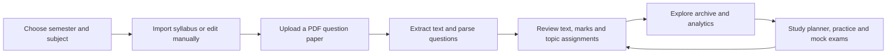
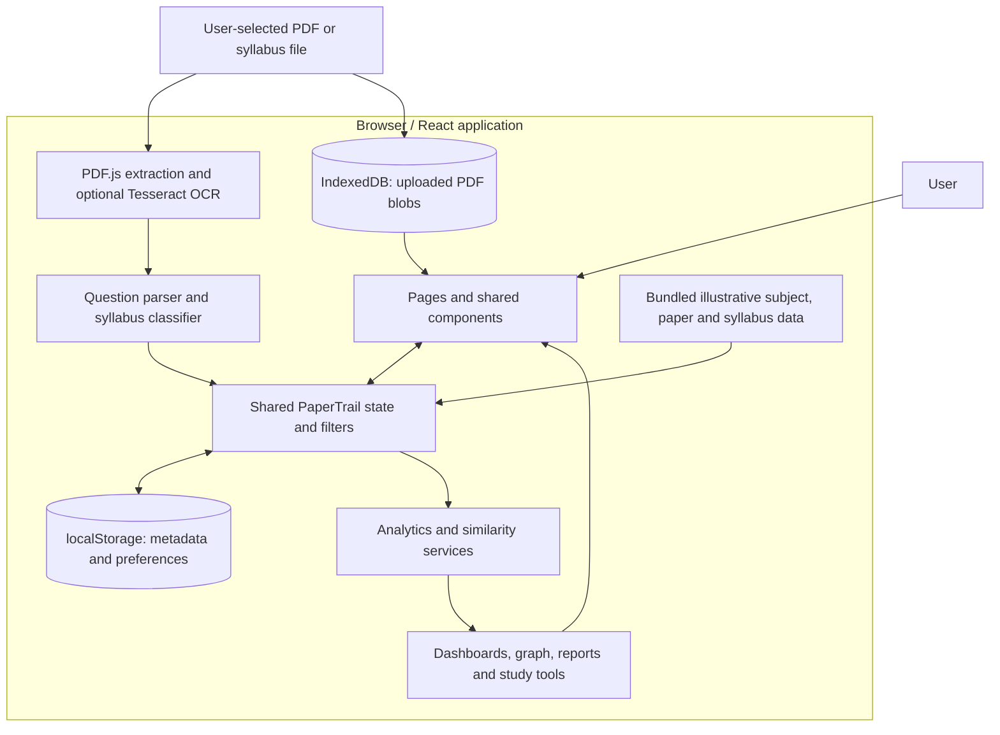
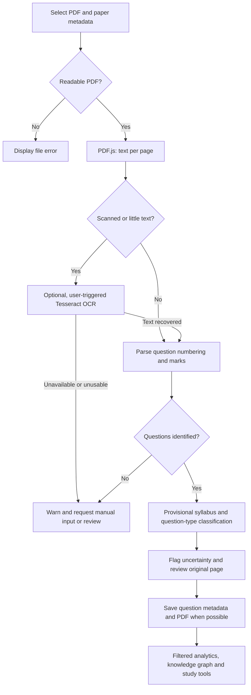

<p align="center">
  
</p>

---
<div align="center">

# PaperTrail

### MIT Manipal Academic Intelligence

**Every question tells a story.**

A browser-based academic intelligence demonstration that turns examination PDFs and syllabus structures into reviewable questions, searchable records, and dataset-driven analysis.

[](https://react.dev/)
[](https://www.typescriptlang.org/)
[](https://vite.dev/)
[](https://vercel.com/)
[](LICENSE)

**[Live demonstration](https://papertrail-mu-red.vercel.app/)** · **[Source repository](https://github.com/dk0204-tech/project_papertrail)** · **[Report an issue](https://github.com/dk0204-tech/project_papertrail/issues)**

**Project status:** Independent demonstration project. **Developer:** [Puneeth Ram](https://github.com/dk0204-tech).

</div>

> [!IMPORTANT]
> PaperTrail is **not an official product of Manipal Institute of Technology (MIT), Manipal, or Manipal Academy of Higher Education (MAHE)**. Its bundled academic examples are synthetic and must not be interpreted as genuine historical MIT Manipal question papers, official syllabi, verified curriculum information, or observed examination statistics.

---

## Contents

- [Overview](#overview)
- [The problem and the approach](#the-problem-and-the-approach)
- [What PaperTrail includes](#what-papertrail-includes)
- [User workflow](#user-workflow)
- [Technology stack](#technology-stack)
- [Architecture](#architecture)
- [Project structure](#project-structure)
- [Document-processing pipeline](#document-processing-pipeline)
- [Academic data model and analytics](#academic-data-model-and-analytics)
- [Data authenticity and provenance](#data-authenticity-and-provenance)
- [Getting started](#getting-started)
- [Deployment on Vercel](#deployment-on-vercel)
- [Local storage and privacy](#local-storage-and-privacy)
- [Verification and testing](#verification-and-testing)
- [Known limitations](#known-limitations)
- [Roadmap](#roadmap)
- [Contributing](#contributing)
- [Acknowledgements and institutional disclaimer](#acknowledgements-and-institutional-disclaimer)
- [Licensing](#licensing)
- [Author](#author)

## Overview

PaperTrail is a **frontend-focused academic intelligence platform** designed around the general eight-semester B.Tech academic structure in the context of MIT Manipal. It combines a semester browser, question-paper archive, PDF extraction workflow, editable syllabus hierarchy, question explorer, analytical dashboards, a visual knowledge graph, and study tools within one React application.

The underlying principle is straightforward:

**Transform scattered examination documents into structured, traceable academic intelligence.**

Rather than treating an uploaded paper as an opaque file, PaperTrail attempts to associate individual questions with their source paper, source page, marks, examination context, and syllabus topic. This makes the available question collection easier to inspect, filter, compare, and use for preparation.

PaperTrail is a **demonstration**, not an institutional academic records service. It comes with reproducible illustrative data so its interface can be explored without uploads. Its findings are meaningful only within the particular dataset being analysed; they do not by themselves establish real examination patterns.

## The problem and the approach

Academic preparation often spans disconnected resources: PDFs of examination papers, manually curated subject lists, syllabus documents, notes, and isolated spreadsheets. The gaps between these resources make it difficult to trace a question back to its paper, understand what has and has not been covered, or compare the same topic across available years.

PaperTrail addresses this at the application level by:

1. **Organising** subjects and papers by programme, department, semester, year, and examination type.
2. **Extracting** text and question structure from uploaded PDF documents, with optional OCR for scans.
3. **Mapping** extracted text to editable syllabus units, chapters, topics, and subtopics using explainable heuristics.
4. **Reviewing** ambiguous or incomplete classifications before relying on them.
5. **Analysing** the resulting question records through filters, charts, repetition groups, syllabus coverage, and reports.
6. **Reusing** recorded questions in a study planner, practice sessions, and self-graded mock examinations.

The product does not automatically verify that an uploaded examination paper is authentic, nor does it obtain official archives on the user's behalf.

## What PaperTrail includes

### 1. Eight-semester academic library

The `/semesters` interface presents an interactive eight-semester bookshelf, from **Semester 1 through Semester 8**. Each semester serves as a navigation entry point for the subjects and paper records available in the current application dataset. Selection connects to shared subject and filter state so the corresponding academic views can be explored in context.

The shelf represents an application navigation model, not a claim that genuine question papers or verified curriculum material are present for every semester.

### 2. Academic dashboard

The `/dashboard` view summarises records within the active filter scope. Depending on the loaded data, it shows:

- Paper and question counts; subject and semester representation.
- Covered academic years and examination categories.
- Marks totals and distributions.
- Topic, subject, and semester comparisons and chart-driven exploration.
- Indicators for low-confidence classifications and questions requiring review.
- Indicators intended to help assess dataset completeness and quality.

The shared `useAnalytics` hook derives its inputs from the filtered records. Consequently, dashboard figures change with the current question-paper collection and the selected filters; they are **not institution-wide statistics**.

### 3. Previous-year question-paper archive

The application provides `/upload`, `/archive`, and `/questions` surfaces for managing papers and their extracted questions.

| Capability | Implemented behaviour |
|---|---|
| PDF intake | Select or drag and drop multiple PDF files, subject to a **25 MB per-file** upload check. |
| Paper metadata | Associate a file with a subject, academic year, session, exam type, and marks information. |
| Examination categories | Upload form supports **Midterm, Endterm, Makeup, Internal, and Supplementary**. |
| Archive | Browse/filter paper metadata, review associated questions, and access a locally stored PDF where available. |
| Duplicate checks | Upload checks existing filenames; the archive also flags possible duplicates based on record metadata. These are not cryptographic content-hash checks. |
| Traceability | Extracted questions retain `paperId`, `sourcePage`, subject context, and examination metadata. |
| Corrections | Review or edit questions and classifications; add or delete records manually. |
| Export | Export appropriate paper/question/analytics views as CSV or structured JSON where exposed by the interface. |

Bundled demo paper entries are **synthetic records**, not downloadable copies of real historical PDF question papers.

### 4. PDF extraction and OCR

The upload flow uses **PDF.js** in the browser to extract positioned text items from each page and reconstruct readable lines. A rule-based parser attempts to recognise common question and subquestion numbering patterns, question bodies, and marks. Page references are preserved for review.

For scanned pages with little extractable text, the upload interface offers a separate **Run OCR** action. **Tesseract.js** is loaded when needed and may recover text from page images; OCR is best-effort and its results require inspection. OCR assets or language data may need to be fetched from external resources.

The application records extraction diagnostics, including text/scanned-page counts, extracted character counts, warnings, whether OCR was used, and a confidence-related field where available. These values are not guarantees of correctness.

See [Document-processing pipeline](#document-processing-pipeline).

### 5. Syllabus intelligence

The syllabus editor at `/syllabus` supports:

- Manual syllabus organisation and editing.
- Importing a structured JSON syllabus.
- Importing a text-readable syllabus PDF through a conservative, rule-based parser.
- Exporting a syllabus as JSON.
- Associating a syllabus with a subject and updating question classifications.

The conceptual academic context is **programme → department → scheme/regulation metadata → semester → subject**. Within a subject, PaperTrail models:

```text
Subject
└── Unit
    └── Chapter
        └── Topic
            └── Subtopic
```

The implementation stores these as TypeScript objects associated with each subject; it does **not** maintain an institutional relational curriculum database. The demo scheme metadata and demo syllabus structures are illustrative, not authoritative MIT Manipal curricula. PDF import can omit or misclassify headings, so the editor is an essential part of the workflow.

### 6. Academic analytics

The application exposes separate views for the following analytical areas:

| View | Route | Main question |
|---|---|---|
| Topic analysis | `/analytics/topics` | Which topics occur in the records currently in scope? |
| Chapter analysis | `/analytics/chapters` | How are questions and marks distributed by chapter? |
| Marks analysis | `/analytics/marks` | How do known question marks vary across selected dimensions? |
| Trends | `/analytics/trends` | How do recorded counts, marks, and topics differ by year? |
| Repetition | `/analytics/repetition` | Which questions have similar normalised wording? |
| Syllabus coverage | `/analytics/coverage` | Which mapped syllabus topics appear in the loaded records? |

The analytics service also calculates unit summaries, question difficulty distributions, cross-subject term recurrence, semester summaries, and subject summaries used across the interface. Chart exploration, filters, and record drill-downs are based on these derived aggregates.

**Important:** Frequency means frequency **within the available, filtered records**. Low coverage may mean that documents are missing, extraction is incomplete, or questions are unclassified—not necessarily that a curriculum area is unimportant or unexamined.

### 7. Academic knowledge graph

The `/knowledge-graph` page builds a visual hierarchy from the currently available question records:

`Semester → Subject → Unit → Topic`

It represents links between academic categories and their questions, supports navigation to related question views, and includes cross-subject concept analysis. The visualisation is computed inside the browser; **there is no Neo4j database, server-side knowledge graph, or embedding-based semantic graph** in the inspected code. Large hierarchies may be grouped into summary nodes to keep the visualisation readable.

### 8. Study and practice tools

| Tool | Behaviour |
|---|---|
| Study planner (`/planner`) | Organise selected subject/topic work using priorities, progress statuses, target dates, and checklists. |
| Practice (`/practice`) | Choose questions using subject, topic, difficulty, type, year, marks, and optional timing; self-assess; maintain local bookmarks and a revision queue. |
| Mock examination (`/mock-exam`) | Assemble a paper from available questions with configurable criteria, marks target, and timer; mark attempted questions and review an attempt summary. |
| Question explorer (`/questions`) | Search, filter, inspect, correct, manually classify, and confirm or flag questions. |
| Consolidated report (`/report`) | Review charts and data-quality notes and export report data as JSON/CSV; use the browser print function to save a PDF. |
| Settings (`/settings`) | Inspect local data and storage usage; export structured data; delete uploaded documents; reset data and preferences. |

**Practice and mock exams are self-assessed.** The software does not generate validated answer keys, automatically mark free-text answers, or award examination grades.

### 9. Interface and navigation

PaperTrail includes a motion-driven landing page, the semester bookshelf, and a `TypographyVortexCanvas` transition component from `@designcodeio/threeui`. Its visual experience uses React Router, Framer Motion, GSAP/ScrollTrigger, Tailwind CSS, and custom CSS. The code includes reduced-motion handling for key animated surfaces and lazy-loads route components.

These choices aim to make a dense academic information system approachable; they are interface features, not evidence of completeness or analytic accuracy.

## User workflow



**Recommended sequence:** begin by selecting or adding a subject, check that its syllabus is appropriate, upload one small text-based PDF, review the extracted questions before confirmation, then explore filtered analytics. For scanned files, use the optional OCR action and verify the result against the original page.

## Technology stack

The following libraries and versions are grounded in the inspected `package.json`. Caret versions allow compatible updates when dependencies are reinstalled; the lockfile pins the resolved dependency tree.

| Technology | Version declared | Role |
|---|---:|---|
| React / React DOM | 18.3.1 | Application UI |
| TypeScript | 5.6.3 | Type-checking and domain models |
| Vite | Toolchain using `@vitejs/plugin-react` 4.3.3 | Development server and production bundling |
| React Router DOM | 6.28.0 | Page routing and navigation |
| PDF.js (`pdfjs-dist`) | 3.11.174 | PDF text extraction, workers, and page rendering |
| Tesseract.js | `^5.1.1` | Optional OCR of scanned paper pages |
| Recharts | 2.13.3 | Interactive analytics charts |
| Framer Motion | 11.11.17 | UI and route animation |
| GSAP | 3.12.5 | Landing-page animation and scroll effects |
| `@designcodeio/threeui` | `^1.2.0` | Typography Vortex transition |
| Tailwind CSS | 3.4.14 | Utility CSS and application theme |
| Lucide React | 0.460.0 | Icons |
| IndexedDB | Browser API | PDF Blob storage |
| localStorage | Browser API | Structured records, filters, and study state |
| Vercel | Hosting platform | Static SPA deployment |

The project also declares `canvas-confetti`, `clsx`, `tailwind-merge`, `autoprefixer`, and `postcss`. No custom backend service, hosted database, authenticated user service, or machine-learning model is required by the inspected application code.

## Architecture

PaperTrail is a **client-rendered single-page application**. Its shared context store holds academic entities, merges illustrative and user-created records, and supplies filtered question-paper data to analytics hooks and pages. Processing services are local TypeScript modules, and persistence uses browser storage.



**Primary implementation boundaries:**

- **Presentation:** `src/pages/`, `src/components/`, `src/layouts/`, `src/index.css`.
- **State:** `src/store/PaperTrailStore.tsx`, `src/hooks/useAnalytics.ts`.
- **Data and domain types:** `src/types/index.ts`, `src/data/`.
- **Document and analysis logic:** `src/services/`, with an analysis interface and local/demo adapters in `src/engines/`.
- **Persistence:** `src/storage/localStorage.ts` and `src/storage/indexedDB.ts`.
- **Application entry and navigation:** `src/main.tsx`, `src/App.tsx`.

There is no background server that ingests uploaded papers. Uploaded document content is processed in the user's browser, subject to the external asset caveats in [Local storage and privacy](#local-storage-and-privacy).

## Project structure

Representative source tree, based on the uploaded project archive and the public repository's top-level listing. Generated build output and third-party dependencies are intentionally abbreviated.

```text
project_papertrail/
├── src/
│   ├── App.tsx                    # Lazy-loaded routes and app boundaries
│   ├── main.tsx                   # React application bootstrap
│   ├── index.css                  # Global visual styles
│   ├── components/                # Navigation, filters, shared UI, transitions
│   ├── data/                      # Bundled illustrative academic data
│   ├── engines/                   # Analysis contracts and local/demo adapters
│   ├── hooks/                     # Derived analytics hook
│   ├── layouts/                   # Application layout
│   ├── pages/                     # Library, ingestion, analytics and study screens
│   ├── services/                  # Extraction, parsing, mapping, analysis, export
│   ├── storage/                   # IndexedDB and localStorage helpers
│   ├── store/                     # Shared PaperTrail context state
│   └── types/                     # Academic types and filter interfaces
├── docs/                          # Present in the public GitHub repository
├── dist/                          # Generated Vite build output
├── index.html                     # HTML entry and external font links
├── package.json                   # Dependencies and scripts
├── package-lock.json              # npm lockfile
├── tsconfig.json                  # TypeScript configuration
├── vite.config.ts                 # Vite and React plugin configuration
├── tailwind.config.js             # Design tokens and Tailwind configuration
├── postcss.config.js              # CSS processing configuration
├── vercel.json                    # SPA fallback rewrite
├── README.md                      # Project documentation
└── LICENSE                        # MIT license for eligible original code
```

`README.md` and `LICENSE` in the tree are the companion files provided with this documentation. The inspected ZIP did **not** contain `public/` or `src/shaders/`, so those directories are not documented as implemented.

### Notable source modules

| Path | Responsibility |
|---|---|
| `src/services/pdfExtraction.ts` | PDF.js text extraction, scanned-page identification, OCR helper, page rendering. |
| `src/services/questionParser.ts` | Question-number parsing, subquestions, marks, page lineage. |
| `src/services/topicClassifier.ts` | Explainable syllabus token matching and provisional classification. |
| `src/services/similarityAnalyzer.ts` | Normalised tokens, Jaccard similarity, question clusters. |
| `src/services/syllabusMapper.ts` | JSON/PDF syllabus import and JSON export. |
| `src/services/analyticsEngine.ts` | Filtering, distribution metrics, time series, repetition and coverage. |
| `src/services/reportExporter.ts` | CSV/JSON downloads and browser printing. |
| `src/engines/LocalAnalysisEngine.ts` | Local extraction/classification adapter. |
| `src/engines/DemoAnalysisEngine.ts` | Adapter for illustrative demo records. |
| `src/store/PaperTrailStore.tsx` | User and demo records, modifications, shared filters, planner persistence. |

## Document-processing pipeline

### Step 1. Ingest and validate

The user chooses one or more PDF files and supplies the paper's academic metadata. The upload UI checks the file type and a **25 MB per-file** limit, and flags filename collisions with papers already present in the archive. The chosen file remains a browser `File` object for processing.

### Step 2. Extract page-level text

`extractPdfText()` opens the file using PDF.js and reads positioned text items page by page. Text items are sorted by approximate page coordinates and reconstructed into lines. Pages with fewer than 40 extracted characters are flagged as likely scanned, and warnings are attached to the result.

### Step 3. Optionally run OCR

For scanned content, users may invoke **Run OCR** on an uploaded item. The `ocrPage()` helper renders a page to a canvas and passes it to Tesseract.js using English language recognition. OCR can fail when assets are unavailable or images are difficult to read. The upload workflow describes recovered text as requiring review; OCR results are not an authenticated transcription.

### Step 4. Identify questions and marks

`parseQuestionsFromPages()` applies regular expressions for numbered questions (`1.`, `Q1)`, etc.), lettered subquestions (`(a)`, `b)`), and common marks annotations (such as `[8]` or `(8 marks)`). It preserves page numbers and returns warnings for unsupported structure or empty results.

The parser is **heuristic**: multi-column layout, unusual numbering, figures, and OCR errors can produce omissions or incorrect question boundaries.

### Step 5. Map questions to syllabus terms

`classifyQuestion()` tokenises and normalises question text, compares it with entries built from the subject's available syllabus, and proposes a unit, chapter, topic and subtopic. It also derives a rough question type, difficulty and cognitive level. Records contain:

- `classificationSource`: `syllabus-match`, `keyword-provisional` or `manual`.
- `confidence`: an explainable **heuristic score**, not a calibrated model probability.
- `matchedKeywords` and `explanation`: indications of why the proposed match was made.
- `needsReview`, `confirmed` and `sourcePage`: review state and traceability.

Low-scoring, ambiguous, or markless records can be flagged for review; users can edit the result and confirm or manually classify it. This is **not** an AI model trained to understand the semantic meaning of examination questions.

### Step 6. Persist and analyse

Paper and question metadata are saved via the application's shared store into `localStorage`; when browser storage permits, the uploaded PDF Blob is also saved in IndexedDB for later preview. The analytical services consume the active question and paper collections, producing tables, charts, reports, and study pools.



### Similarity and repeated-question analysis

`similarityAnalyzer.ts` lowercases and normalises question wording, removes common stop words, includes token bigrams, and compares questions **within the same subject** using Jaccard similarity:

$$
J(A,B) = \frac{|A \cap B|}{|A \cup B|}
$$

The analytics hook requests candidate groups at a threshold of **0.55**, and the clustering code assigns descriptive categories such as exact, near-identical, similar structure, and same-topic variant according to pair similarity scores. The grouping is a useful **textual heuristic**, not a semantic-embedding comparison or proof that two questions test exactly the same concept.

## Academic data model and analytics

### Core entities

The inspected TypeScript model includes `Subject`, `Paper`, `Question`, `Syllabus`, `SyllabusUnit`, `SyllabusChapter`, `SyllabusTopic`, `FilterState`, and result interfaces for topic/chapter/unit analytics, trends, repetition and coverage.

A question record links its text to a `paperId`, `subjectId`, academic context, source page, optional marks, classification details and review state. A paper record includes semester, year, exam type, file metadata, extraction diagnostics, and a `demo` flag.

**Note on provenance:** a `demo` flag distinguishes generated examples from other records, and syllabus records carry a `provenance` enum (`demo-illustrative`, `user-upload`, `user-manual`). The current data model does **not** establish a complete independent verification ledger proving that a user-uploaded document is an official examination paper.

### Filter dimensions

The shared filter interface supports department, programme, year, semester, subject, exam type, unit, chapter, and topic. Analytics are recalculated for the current scope by `useAnalytics()` and the service helpers, rather than by a persistent remote analytics database.

### How to interpret computed measures

| Measure | Interpretation |
|---|---|
| Question count | Number of question records in the current scope. |
| Paper count | Number of paper records matching the current paper filters. |
| Topic frequency | In-scope papers containing a mapped topic relative to the applicable in-scope paper collection. |
| Recorded marks | Sum/distribution of detected or manually entered question marks; missing marks may affect totals. |
| Historical trends | Grouped values by year **within available records**, not inferred examination forecasts. |
| Syllabus coverage | Topics with at least one mapped question divided by syllabus topics represented in the current coverage calculation. |
| Repetition clusters | Question groups formed by normalised textual similarity, subject scope, and a configured threshold. |
| Confidence / review | Heuristic classification evidence and flags for human verification; not model accuracy percentages. |

Coverage can be misleading when the syllabus is missing or synthetic, the paper collection is incomplete, or extracted questions are incorrectly classified. Treat analysis as a tool for exploring evidence, not predicting future examinations.

## Data authenticity and provenance

PaperTrail intentionally distinguishes **illustrative demonstration data** from actual documents supplied by users.

| Data category | What it represents | What it does **not** establish |
|---|---|---|
| Bundled demo subjects and syllabi | Fictional examples defined in `src/data/demoSubjects.ts` and `src/data/demoSyllabus.ts`. | Official course codes, curriculum, credits, or regulation. |
| Generated demo papers and questions | Deterministically generated sample records from `src/data/demoDataset.ts`. | Genuine past examination papers or observed historical patterns. |
| User-uploaded PDF | A document selected locally and parsed into an application record. | Authenticity, authorisation, or official provenance. |
| Auto-extracted question | Text parsed from an available page and associated with a paper. | Error-free transcription, complete marks, or correct parsing. |
| Syllabus-matched question | A keyword-based proposed association with the active syllabus. | Human-verified conceptual classification. |
| Manually reviewed question | A user-confirmed or edited application record. | Independent institutional verification. |
| Verified historical documents, if later added | Documents that would need independently established provenance. | A verified collection already exists in the inspected demo bundle. |

The built-in demo generator uses illustrative year, examination-type, subject, and question combinations solely to exercise application features. **Never cite its trends, coverage percentages or repetition counts as MIT Manipal examination evidence.**

As provided, the software cannot guarantee comprehensive access to past papers across any semester or programme. The availability and reliability of real-record analytics depend entirely on the source documents, extracted text, topic mapping, manual review, and provenance checks available to the user.

## Getting started

### Prerequisites

- **Node.js** with npm (a current maintained LTS release is recommended).
- **Git** to clone the repository.
- A modern browser with IndexedDB, localStorage, Canvas, and JavaScript support.

### Install and start the development server

```bash
git clone https://github.com/dk0204-tech/project_papertrail.git
cd project_papertrail
npm ci
npm run dev
```

Open the local address printed by Vite, usually **`http://localhost:5173/`**. If that port is occupied, Vite may choose another available port; use the actual terminal output.

`npm ci` uses the committed `package-lock.json` and performs a clean, reproducible dependency installation. It is preferred over copying `node_modules` between operating systems.

### Scripts

These commands are defined in the inspected `package.json`:

| Command | Actual action |
|---|---|
| `npm run dev` | Start Vite's development server. |
| `npm run build` | Run TypeScript compilation/type-checking (`tsc`) and then `vite build`. |
| `npm run preview` | Serve an existing production build through Vite's preview server. |
| `npm run lint` | Prints `No lint script configured`; **this is not a linter**. |

```bash
# Check TypeScript and create a dist/ production bundle
npm run build

# Preview the generated production bundle locally
npm run preview
```

The application requires no database credentials, server configuration, or API key for its documented local workflow.

### Typical first-run checks

1. Visit `/semesters` and `/dashboard` to inspect the illustrative demonstration state.
2. Open `/syllabus` and review or import a syllabus for the intended subject.
3. Visit `/upload`, select a PDF, and supply correct paper metadata.
4. Review extracted questions, marks, page references, and topic assignments.
5. Explore `/questions`, `/analytics/topics`, `/analytics/coverage`, and `/report` using relevant filters.
6. Use `/practice`, `/planner`, or `/mock-exam` with the resulting question collection.

## Deployment on Vercel

The public repository lists the deployed application at **[papertrail-mu-red.vercel.app](https://papertrail-mu-red.vercel.app/)**. This link is sourced from the repository's GitHub About section; deployment availability may change independently of the source.

For another deployment, connect the repository to Vercel and use the configuration below:

| Setting | Value |
|---|---|
| Platform | Vercel |
| Project framework | Vite |
| Root directory | `./` |
| Install command | `npm ci` |
| Build command | `npm run build` |
| Output directory | `dist` |

The repository includes `vercel.json`:

```json
{
  "rewrites": [
    { "source": "/(.*)", "destination": "/index.html" }
  ]
}
```

This is a **single-page-application fallback**, allowing direct navigation and refreshes on paths such as `/dashboard` or `/analytics/topics` to reach the React router. Vercel can trigger builds automatically when configured against a GitHub branch; the particular trigger and production-branch settings depend on the Vercel project's configuration.

There are no required application-specific environment variables in the inspected source. Because user data is stored in the **browser**, deploying to Vercel does **not** create a shared question-paper database or synchronise uploaded documents between browsers, profiles, devices or origins.

## Local storage and privacy

| Storage location | Stored material | Implementation |
|---|---|---|
| `localStorage` | Uploaded paper/question metadata, edits, syllabi, subjects, filters, planner entries, demo settings and study-related state. | `src/store/PaperTrailStore.tsx`, `src/storage/localStorage.ts` and study pages. |
| IndexedDB | Best-effort retention of uploaded PDF Blobs for later preview. | `src/storage/indexedDB.ts`, database `papertrail`, object store `documents`. |
| In-memory state | Current upload queue, processing results, components and session interactions. | React state. |

**Privacy boundaries and caveats:**

- The inspected application processes user-selected PDF content on the client; it does not include a document-upload API to a PaperTrail backend.
- Uploads are **not automatically shared with other users** or synchronised to a central service.
- Browser storage is specific to the current origin and browser profile, limited by quotas, and may be cleared or evicted. Browser-private sessions may not retain data.
- `localStorage` and IndexedDB are **not equivalent to encrypted, access-controlled cloud storage**. People or scripts with access to the browser profile/origin may be able to inspect them.
- PDF Blob persistence is best-effort. If IndexedDB fails or storage capacity is exhausted, the application may retain metadata without retaining the original PDF preview.
- Settings exposes local-data export, deletion of user uploads, and a broader data-clear operation. Exported JSON is a snapshot of structured application data, **not a backup of the original PDF Blobs**.
- The HTML loads Google Fonts from `fonts.googleapis.com`/`fonts.gstatic.com`. Tesseract may request OCR assets or language resources from external locations depending on package configuration. Network requests to these external providers are separate from storing PDFs in a PaperTrail database.
- Deleting browser storage or using **Clear all local data** can permanently remove saved work. Keep independent copies of important source documents.

Avoid uploading confidential institutional or personal records without first reviewing the source code, applicable permissions, and browser security environment.

## Verification and testing

The inspected `package.json` supports a TypeScript-plus-Vite production build, but **does not configure an automated test suite or a working lint command**. The uploaded archive includes prebuilt `dist/` files, which are not proof that every route, browser, or feature has recently passed manual or automated tests.

The following checks are appropriate before publishing a release:

```bash
npm ci
npm run build
npm run preview
```

After a clean installation, manually confirm at minimum that:

- The landing page and deep-linked routes load in the production preview.
- Navigation, global filters, dashboard counts and charts respond to available records.
- A text-based PDF can be uploaded, extracted, reviewed and revisited from the archive.
- A scanned PDF reports its limits and optional OCR behaviour accurately.
- Syllabus JSON import/export and conservative syllabus PDF import behave as described.
- Question review, document deletion, practice state and browser-local persistence work in the target browsers.
- The SPA fallback works in the deployed hosting environment.

**Verification performed while preparing these documents:** the TypeScript check completed successfully against the supplied source snapshot. A full Vite bundle could not be independently completed in the inspection environment because the ZIP's bundled `node_modules` contained Windows Rollup native packages rather than the Linux-native package required on that host. This does **not** establish either success or failure for a clean `npm ci && npm run build` on a properly configured machine. No automated test run or browser acceptance test is claimed here.

## Known limitations

1. **Frontend-oriented implementation:** no central account system, cross-device sync, or shared database.
2. **Document completeness:** the application does not ship a verified, complete MIT Manipal previous-year-paper corpus.
3. **Illustrative data:** the bundled subjects, curricula, papers, and question records are synthetic demonstration material.
4. **Provenance:** user uploads are not independently authenticated or certified as official examination documents.
5. **PDF structure:** question parsing can struggle with scanned, multi-column, diagram-heavy or unusually formatted papers.
6. **OCR quality:** recognition depends on page quality, available assets, language and layout; manual correction remains necessary.
7. **Mapping approach:** keyword matching is heuristic; it is not an embedding model, LLM, or validated semantic classifier.
8. **Similarity:** Jaccard overlap may group lexically similar but conceptually different questions or miss paraphrases.
9. **Marks and metrics:** missing marks, unclassified questions and sparse yearly data limit the reliability of aggregated findings.
10. **Local persistence:** device/browser restrictions, clearing storage or quota failures may cause loss of retained data or previews.
11. **Assessment tools:** practice and mock exam interactions are self-assessed, without verified answer keys or automatic grading.
12. **Engineering checks:** automated unit/end-to-end tests, a configured linter and published performance benchmarks are not present in the inspected source.

These are current implementation boundaries, not promises that any future feature is already available.

## Roadmap

The following are **proposed directions**, not completed features or committed delivery dates:

- [ ] Establish provenance rules and permission-aware workflows for genuine question-paper collections.
- [ ] Expand and verify subject/syllabus support across applicable semesters, programmes, and departments.
- [ ] Add richer PDF structure handling, user-guided segmentation and more reliable scanned-page OCR.
- [ ] Improve question parsing, marks recognition and traceable review controls.
- [ ] Improve explainable syllabus matching with measurable evaluation on permissioned test material.
- [ ] Introduce stronger duplicate detection and more nuanced question-similarity analysis.
- [ ] Add dataset completeness indicators that explicitly separate missing records from observed zero-frequency topics.
- [ ] Improve offline export, backup/restore and original-document management.
- [ ] Add automated tests, continuous integration, accessibility checks and cross-browser verification.
- [ ] Explore optional advanced academic intelligence techniques only when supported by validated implementation and data.

## Contributing

PaperTrail is presented as an independent educational software demonstration. If you wish to propose an improvement, open a [GitHub issue](https://github.com/dk0204-tech/project_papertrail/issues) with a clear problem description, expected behaviour and relevant reproduction steps. For code changes, prefer focused pull requests that include an explanation and test evidence where possible.

Contributions involving examination papers, syllabi or institutional branding must respect copyright, permissions and attribution requirements. Do not introduce real academic documents as synthetic examples or silently upgrade unverified data to "official" status.

## Acknowledgements and institutional disclaimer

PaperTrail is inspired by the practical difficulties students face when organising scattered academic documents and preparing from available examination materials. Its academic structure is designed in the **context of Manipal Institute of Technology (MIT), Manipal**, a constituent institution of **Manipal Academy of Higher Education (MAHE)**.

**Institutional disclaimer:** PaperTrail is an **independent demonstration project**. It is **not developed, operated, maintained, sponsored, certified, approved or endorsed by MIT Manipal or MAHE**. All institutional names and trademarks are the property of their respective owners. This repository makes no claim to ownership of university logos, examination papers, official syllabi or other third-party academic content. Use and redistribution of such material remain subject to applicable permissions and legal restrictions.

The project uses open-source libraries and browser technologies, whose maintainers and contributors are acknowledged through their respective upstream projects and license notices.

## Licensing

The companion root-level [LICENSE](LICENSE) contains the standard **MIT License** with copyright attribution to **Puneeth Ram (2026)**. It is intended to cover original PaperTrail software code **only to the extent the relevant rights holder has the right to license that code**.

The MIT software license does **not** automatically authorize reuse or redistribution of:

- MIT Manipal or MAHE names as marks, logos or institution-owned branding.
- Official syllabus documents, examination question papers or course materials.
- Third-party imagery, fonts, illustrations, data or code subject to different licenses.
- User-uploaded files, documents or content owned by other rights holders.

Preserve notices and comply with the licenses and terms of all third-party dependencies and assets. An MIT **software license** is not an institutional endorsement or authorization to distribute university documents.

> **Repository metadata note:** At the time of source inspection, `package.json` still declares `"license": "ISC"`. Before publishing the new MIT `LICENSE`, change the project's package metadata to `"license": "MIT"` (and update the lockfile consistently) **if the project owner has the rights to relicense the original code**. Until this is done, the package metadata and proposed license file are inconsistent.

## Author

**Puneeth Ram**  
Developer, PaperTrail — MIT Manipal Academic Intelligence  
GitHub: [@dk0204-tech](https://github.com/dk0204-tech)  
Repository: [dk0204-tech/project_papertrail](https://github.com/dk0204-tech/project_papertrail)

PaperTrail is an independent software engineering and educational-technology demonstration project.

---

<div align="center">

**PaperTrail — Every question tells a story.**

[Explore the demo](https://papertrail-mu-red.vercel.app/) · [Read the source](https://github.com/dk0204-tech/project_papertrail) · [Review the license](LICENSE)

</div>
